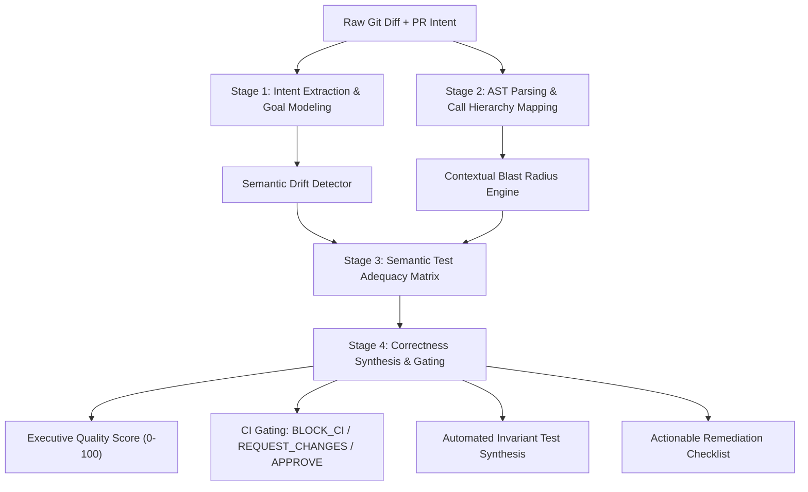

# SentinelSQI System Architecture
## AI-Powered Software Quality Intelligence Engine

---

### 1. Problem Formulation: The "Goodhart's Law" of Software Quality

Modern software engineering teams rely on automated CI/CD pipelines consisting of linters, typecheckers, unit tests, and code coverage thresholds (e.g., 90%+ branch or line coverage). However, **tests passing in isolation does not imply software correctness**. 

This failure mode is an embodiment of **Goodhart’s Law**: *"When a metric becomes a goal, it ceases to be a good metric."*
- **The Mocking Illusion:** Engineers write unit tests that mock database errors, network failures, or secondary services. The tests execute every line of the new code (achieving high coverage), but test suites rarely assert on post-failure invariants, exception handling boundaries, or cross-service side-effects.
- **Context Blindness:** A 10-line change in a utility module might satisfy an immediate ticket requirement while breaking downstream consumers, violating distributed consensus, leaking distributed locks, or degrading multi-tenant security boundaries.
- **Semantic Drift:** The developer's stated requirement (PR description, ticket context) often diverges subtly from the implemented Abstract Syntax Tree (AST) mutations.

**SentinelSQI** was created to bridge this cognitive gap: an automated Quality Intelligence System that understands **what was intended**, analyzes the change in its **systemic context**, and verifies whether the implementation has been **semantically validated** before merging.

---

### 2. Information Architecture: What Signals Does the System Ingest?

To reason comprehensively about correctness, SentinelSQI ingests information across three distinct vectors:

```
┌─────────────────────────────────────────────────────────────────────────────┐
│                       SENTINEL SQI INGESTION VECTORS                        │
├─────────────────────────┬─────────────────────────┬─────────────────────────┤
│    1. INTENT SIGNALS    │  2. CONTEXTUAL SIGNALS  │  3. VALIDATION SIGNALS  │
├─────────────────────────┼─────────────────────────┼─────────────────────────┤
│ • PR Title & Body       │ • AST Parse Trees       │ • Existing Test Code    │
│ • Issue / Jira Tickets  │ • Import / Export Graph │ • Assertion Density     │
│ • Commit Messages       │ • Database Schemas      │ • Mocking Boundaries    │
│ • Code Comments         │ • API Gateway Contracts │ • Invariant Assertions  │
│ • Business Acceptance   │ • Downstream Callers    │ • Edge Case Vectors     │
│   Criteria              │ • State Transitions     │ • Historical CI Runs    │
└─────────────────────────┴─────────────────────────┴─────────────────────────┘
```

#### A. Intent Signals
- **Explicit Intent:** Pull request description, linked user stories, acceptance criteria, and commit message headers.
- **Inferred Intent:** Semantic analysis of functions modified, variables introduced, and operational goals (e.g. "performance optimization", "idempotent retry", "monetary calculation").

#### B. Contextual Signals
- **Code Graph Topology:** Call trees, imported modules, and exported function interfaces.
- **Architectural Layering:** Mapping nodes into entrypoint controllers, domain services, infrastructure adapters, and persistent database entities.
- **Cross-Service Contracts:** Serialization structures, message bus event payloads (e.g., Kafka / SQS messages), distributed lock keys, and cache namespaces.

#### C. Validation Signals
- **Traditional Metrics:** Line coverage, branch coverage, and pass/fail execution statuses.
- **Semantic Assertion Depth:** Examining what assertions actually verify (e.g., asserting that `status === 'ok'` vs asserting that `lockKey` was purged from Redis even when a database error occurred).
- **Boundary & Invariant Coverage:** Identifying missing negative tests, underflow/overflow checks, race conditions, and tenant isolation boundaries.

---

### 3. Cognitive Reasoning Pipeline

SentinelSQI implements a 4-stage cognitive reasoning pipeline combining static AST analysis, topological graph traversal, and generative language intelligence (powered by Google Gemini 2.5):



#### Stage 1: Intent Extraction & Goal Modeling
The engine extracts intended functional contracts from the PR context and compares them against the AST deltas. It produces:
1. **Intended Behaviors:** A decomposed checklist of what the engineer was attempting to achieve.
2. **Unintended Side Effects:** Behavioral mutations introduced by the diff that were not part of the requirement (e.g. altering currency calculation precision or dropping a contract payload field).
3. **Semantic Drift Index:** Quantitative measurement of deviation between stated requirements and AST changes.

#### Stage 2: Contextual Blast Radius & Topological Mapping
Rather than treating files as flat text, the engine constructs a dependency graph:
- **Direct Nodes:** Files and functions modified by additions/deletions.
- **Transitive Nodes:** Callers, downstream subscribers, persistence tables, and external infrastructure (Redis, Kafka, PostgreSQL, Stripe).
- **Vulnerability Traversal:** If a direct node introduces an unhandled exception or altered contract, edges connected to downstream consumers are flagged with hazard annotations.

#### Stage 3: Semantic Test Adequacy Matrix
This stage contrasts **Traditional Line Coverage** against **Semantic Assertion Coverage**:
- **Superficial Pass:** The test executed the line, but used mocks that only resolved successfully, ignoring error branches, finally blocks, and lock releases.
- **Untested Edge Cases:** Boundary values such as zero or negative values, empty payloads, or token expiration windows.
- **Regression Vulnerabilities:** Workflows where existing tests pass because they do not assert on the modified schema or contract.

#### Stage 4: Invariant Test Synthesis & CI Gating
Using the gaps identified in Stage 3, the engine:
1. Synthesizes executable Vitest/Jest unit tests that target the exact uncovered invariant.
2. Computes the composite **Correctness Score (0-100)**.
3. Issues a deterministic CI gate verdict:
   - `BLOCK_CI`: Critical architectural violation, security vulnerability, or unasserted data-loss hazard.
   - `REQUEST_CHANGES`: Missing boundary tests or moderate regression surface.
   - `APPROVE`: High semantic adequacy, verified invariants, and safe blast radius.

---

### 4. Component Architecture of the Prototype

```
myco/
├── src/                          # Modern React 18 + TypeScript + Tailwind UI
│   ├── components/               # Specialized views:
│   │   ├── DashboardOverview     # Scorecards, Goodhart paradox comparison, executive verdict
│   │   ├── IntentAnalysisView    # Stated Intent vs AST reality & semantic drift
│   │   ├── BlastRadiusGraph      # Interactive call hierarchy & dependency node graph
│   │   ├── SemanticTestMatrix    # Assertion depth vs superficial coverage grid
│   │   ├── DiffInspector         # Annotated unified diff with inline hazard callouts
│   │   ├── LiveDiffEditor        # Interactive playground for custom PR diffs
│   │   ├── TestGeneratorModal    # Executable invariant test suite exporter
│   │   └── ExecutiveReportModal  # GitHub PR Markdown & CI telemetry JSON export
│   ├── services/                 # Intelligence Engines:
│   │   ├── analyzer.ts           # Hybrid orchestrator (AST + Graph + Gemini)
│   │   ├── gemini.ts             # Direct Gemini 2.5 REST client with structured prompt
│   │   └── staticParser.ts       # Unified diff & symbol AST extractor
│   └── data/
│       └── scenarios.ts          # 4 Realistic production incident case studies
├── lib/
│   └── core.js                   # Universal AST parser & deterministic reasoning engine
├── cli/
│   └── sentinel.js               # Terminal & CI tool (`npx sentinel-cli`)
├── server/
│   └── index.js                  # Express API server (/api/analyze, /api/health)
└── tests/
    └── sqi.test.js               # Automated Node.js unit tests for the engine
```

---

### 5. Benchmark Incident Scenarios

The prototype includes 4 pre-loaded real-world case studies demonstrating why conventional tests fail:

| Scenario | PR Stated Intent | Underlying Hidden Bug | Traditional CI Status | SentinelSQI Intelligence Verdict |
| :--- | :--- | :--- | :--- | :--- |
| **1. Fintech Webhook Refund** | Add idempotency lock to prevent double refund payouts | Lock acquired without TTL; if DB throws, lock deadlocks future retries forever. Currency formatting drops fractional cents. | **PASS** (98% Coverage) | **BLOCK_CI** (Score: 42/100, Lock deadlock & precision loss) |
| **2. Multi-Tenant RBAC** | Cache user permissions in Redis for 5 minutes | Cache key scoped solely to `userId` rather than `userId + tenantId`, enabling cross-tenant admin escalation. | **PASS** (100% Coverage) | **BLOCK_CI** (Score: 24/100, Critical security breach) |
| **3. E-Commerce Cart Pricing** | Stack seasonal percentage promo with VIP gift voucher | Missing `Math.max(0, total)` boundary clamp allows cart total to underflow to negative balance. | **PASS** (100% Coverage) | **REQUEST_CHANGES** (Score: 48/100, Arithmetic underflow) |
| **4. Cloud Distributed Queue** | Exponential backoff retry for transient network blips | Synchronous busy-waiting loop blocks Node event loop, killing broker heartbeats. Failed messages drop without DLQ. | **PASS** (95% Coverage) | **BLOCK_CI** (Score: 31/100, Thread starvation & data drop) |

