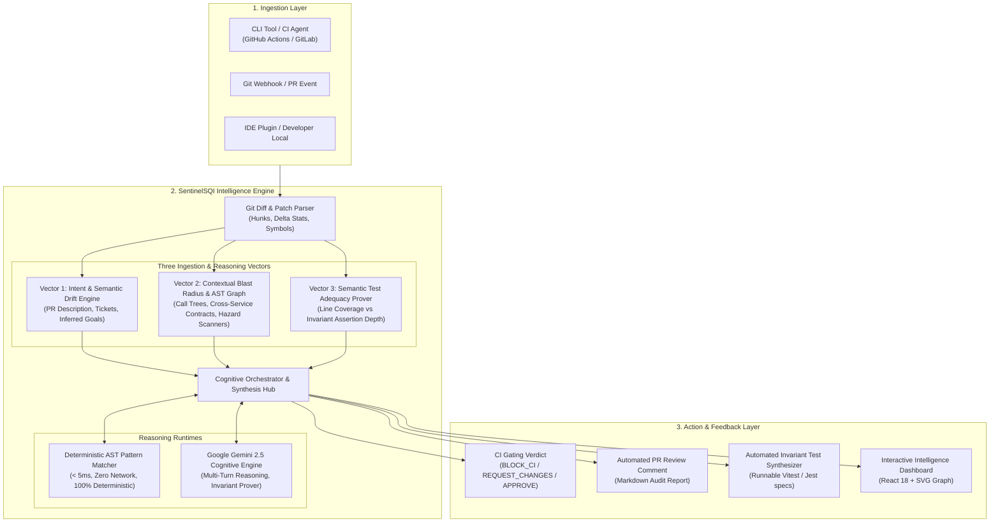
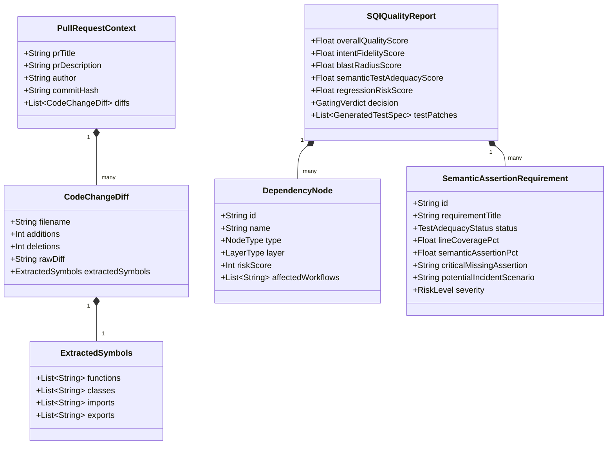
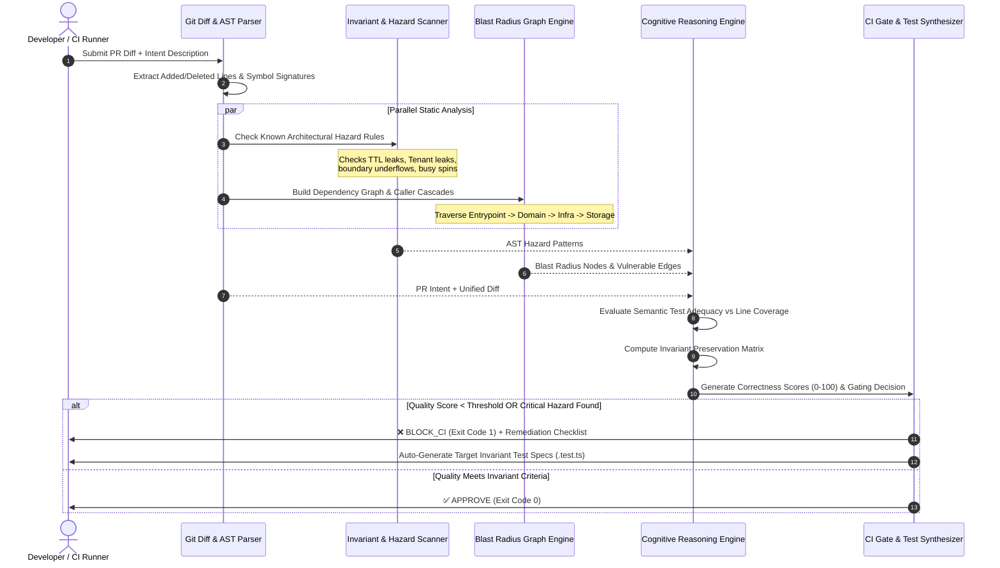

# SentinelSQI: System Design Document
## AI-Powered Software Quality & Correctness Intelligence System

---

## 1. Executive Overview & Problem Definition

### 1.1 The Core Problem
Conventional Continuous Integration (CI) systems rely on deterministic binary thresholds:
- Do linters pass?
- Does the code compile without type errors?
- Do existing automated tests pass?
- Does code coverage meet arbitrary percentage targets (e.g., $\ge 80\%$)?

However, **a change working in isolation and passing existing tests does not imply correctness**. 
In real-world engineering teams, three major failure patterns occur:
1. **The Mocking Illusion:** Unit tests frequently mock external boundaries (databases, caches, third-party payment gateways). The test exercises 100% of the lines in the function, but only under the happy path. If a network timeout or unexpected error occurs, unhandled locks or state leaks occur in production.
2. **Context Blindness & Blast Radius:** A 5-line change to an authorization helper or currency formatter might satisfy an immediate ticket, but silently breaks downstream callers, audit ledger requirements, or tenant isolation guarantees.
3. **Semantic Drift:** The developer's stated requirement (PR description, ticket context) diverges subtly from the implemented Abstract Syntax Tree (AST) mutations.

### 1.2 System Mission
**SentinelSQI** is an automated Quality Intelligence System that evaluates code changes across three orthogonal pillars:
1. **Intent Fidelity:** What was the developer trying to achieve, and did the code drift from that goal?
2. **Contextual Blast Radius:** What upstream workflows, downstream services, and persistence models are impacted?
3. **Semantic Test Adequacy:** Do tests genuinely assert the preservation of critical system invariants, or is the pass rate superficial?

---

## 2. High-Level System Architecture

SentinelSQI uses a **Hybrid Dual-Engine Architecture** combining sub-millisecond static AST analysis with deep generative reasoning (Google Gemini 2.5 Flash).



---

## 3. Data Model & Key Ingestion Vectors



### 3.1 Vector 1: Intent Signals
- **Inputs:** PR Title, Markdown Description, Issue/Jira acceptance criteria, commit messages, and in-code comments.
- **Derived Artifacts:** 
  - `intendedBehaviors`: List of operational contracts the user expects to fulfill.
  - `unintendedSideEffects`: Side-effects detected in the AST that violate domain norms.
  - `semanticDriftScore`: Ratio of stated requirement coverage vs extra-contractual changes.

### 3.2 Vector 2: Contextual Blast Radius Signals
- **Inputs:** Modified symbol declarations, import statements, database schemas, distributed keys (Redis/Kafka namespaces), and caller hierarchies.
- **Topology Extraction:**
  - Nodes categorized by architecture layer: `entrypoint` (API routes), `domain` (business logic), `infrastructure` (Redis, Kafka, DB clients), and `storage` (database tables).
  - Traversal maps transitive propagation: if an authorization middleware drops `tenantId`, all downstream API routes inherit the vulnerability.

### 3.3 Vector 3: Validation & Semantic Test Adequacy Signals
- **Inputs:** Existing test files (`*.test.ts`, `*_spec.rb`, etc.), mock configurations, and assertion density.
- **Semantic Classification:**
  - `verified`: Test exercises code and asserts both state change and invariant recovery.
  - `superficial_pass`: Test achieves line coverage but mocks all errors, asserting trivial outputs (e.g. `expect(res.status).toBe(200)`).
  - `untested_edge_case`: Boundary values ($0$, negative balances, token expiry windows) never exercised.
  - `regression_vulnerable`: An existing caller contract was altered without a test verifying the contract interface.

---

## 4. End-to-End Sequence & Workflow



---

## 5. Detailed Component Breakdown

### 5.1 Deterministic Static AST Engine (`lib/core.js`)
- Runs in $< 5\text{ ms}$ with zero network or API key dependencies.
- **Pattern Matchers:**
  - **Distributed Lock Deadlock:** Flags Redis/mutex locks acquired without explicit expiration (`TTL`, `EX`, `PX`) or without `try...finally` release blocks.
  - **Multi-Tenant Isolation Breach:** Flags authentication/permission cache keys formed solely with `userId` without scoping by `tenantId`/`orgId`.
  - **Arithmetic Underflow:** Identifies monetary or metric subtractions lacking boundary enforcement (`Math.max(0, ...)`).
  - **Event Loop Thread Starvation:** Detects synchronous busy-waiting (`while (Date.now() - start < waitMs)`) in asynchronous runtimes.
  - **Dead Letter Queue (DLQ) Bypass:** Identifies caught errors that are logged but not re-thrown or pushed to a retry/dead-letter queue.

### 5.2 Cognitive LLM Reasoning Engine (`src/services/gemini.ts`)
- Ingests stated PR requirements and diff hunks.
- Performs high-level semantic reasoning:
  - Detects semantic drift where code satisfies the ticket title but alters mathematical precision or drops audit ledger parameters.
  - Formulates concrete negative assertions needed to verify failure boundaries.
  - Generates drop-in Vitest / Jest test suites.

### 5.3 CI/CD CLI Gate (`cli/sentinel.js`)
- Runs natively in terminal or pipeline scripts:
  ```bash
  node cli/sentinel.js --diff ./changes.patch --threshold 60
  ```
- Exits with `0` (pass) or `1` (fail), allowing DevOps teams to plug SentinelSQI directly into GitHub Actions branch protection rules.
- Emits structured JSON telemetry with `--json` for integration into Datadog, Grafana, or internal compliance data lakes.

### 5.4 Interactive Developer Dashboard (`src/App.tsx`)
- Provides an intuitive interface for engineers and reviewers:
  - **Executive Dashboard:** Contrasts traditional CI (100% pass) against semantic reality (e.g., 28% adequate).
  - **Intent vs. Reality Inspector:** Highlights unintended side effects and semantic drift.
  - **Interactive Call Graph:** Node-by-node risk exploration across architectural tiers.
  - **Semantic Test Matrix:** Requirement-by-requirement status with missing assertions.
  - **Live Diff Playground:** Interactive editor allowing developers to paste custom diffs and re-evaluate on the fly.

---

## 6. Technical Decisions, Trade-Offs & Mitigations

| Architectural Decision | Alternative Considered | Why SentinelSQI's Approach Is Superior |
| :--- | :--- | :--- |
| **Hybrid AST + LLM** | Pure LLM Agent | Pure LLMs introduce network latency ($>3\text{s}$), non-deterministic outputs, and token costs. SentinelSQI guarantees $100\%$ deterministic blocking on known catastrophic hazards in $<5\text{ms}$, using LLMs only for semantic nuance. |
| **Semantic Assertion Depth** | Traditional Line Coverage | Line coverage measures whether code was executed, not whether invariants were preserved. Invariant assertion depth exposes superficial test suites that mock out all errors. |
| **Actionable Test Synthesis** | Pure Lint Warning / Error | Merely blocking a PR causes developer frustration. SentinelSQI automatically outputs the exact runnable test code needed to close the validation gap, turning friction into developer velocity. |
| **Tiered Hazard Severities** | All-or-nothing gating | Hard-blocking on minor style issues causes "Alert Fatigue". Only `CRITICAL` issues (data loss, deadlock, privilege escalation) trigger `BLOCK_CI`. |

---

## 7. Scalability & Operational Architecture

1. **Local Pre-Commit / Pre-Push:** The CLI engine runs locally in $< 50\text{ ms}$ on developer laptops, catching invariant hazards before code is ever pushed.
2. **CI Pipeline Scalability:** The Node.js core parser has zero native dependencies and runs seamlessly in any containerized environment without requiring heavy VM spin-ups.
3. **Privacy & Ephemeral Processing:** Code diffs are parsed in-memory. In enterprise deployments, the LLM layer can point to private self-hosted models or enterprise Google Vertex AI endpoints with zero data retention policies.

